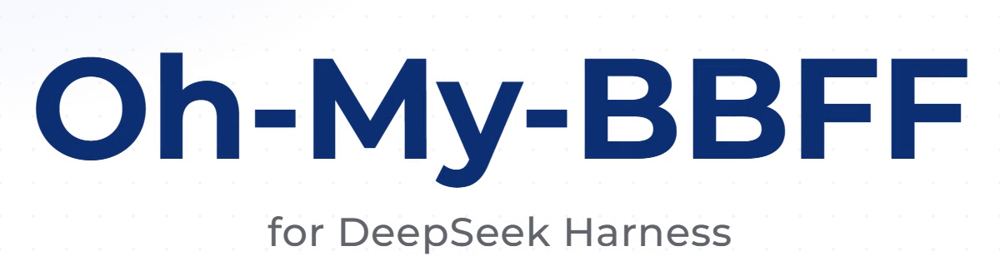
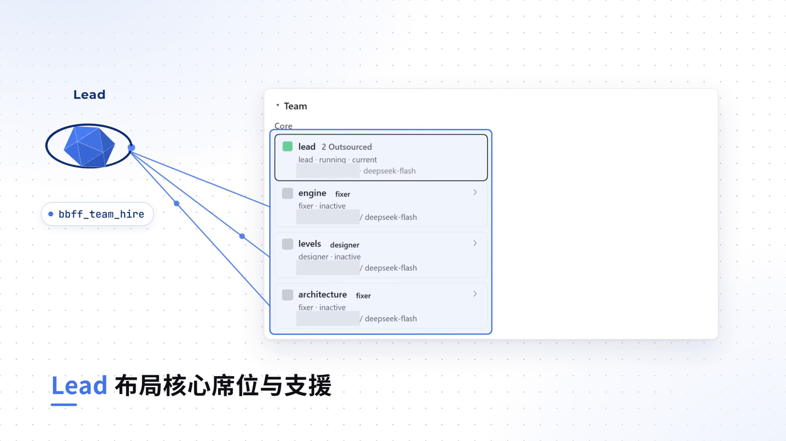
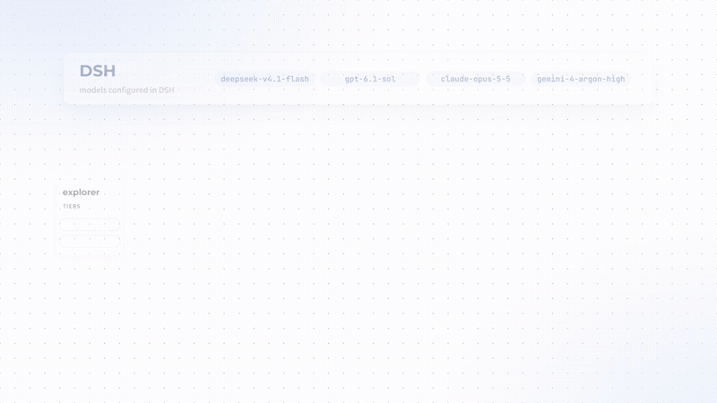
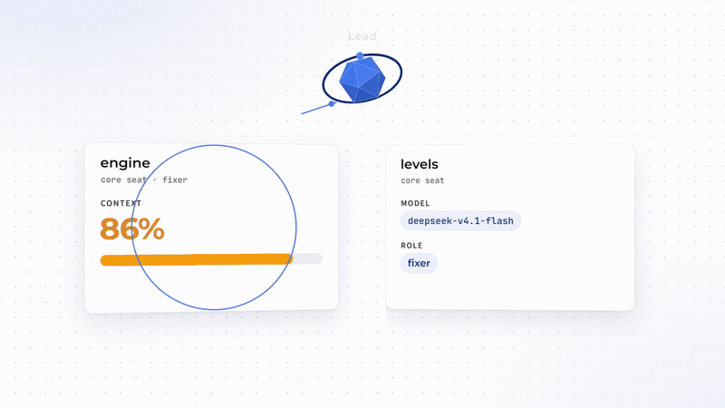
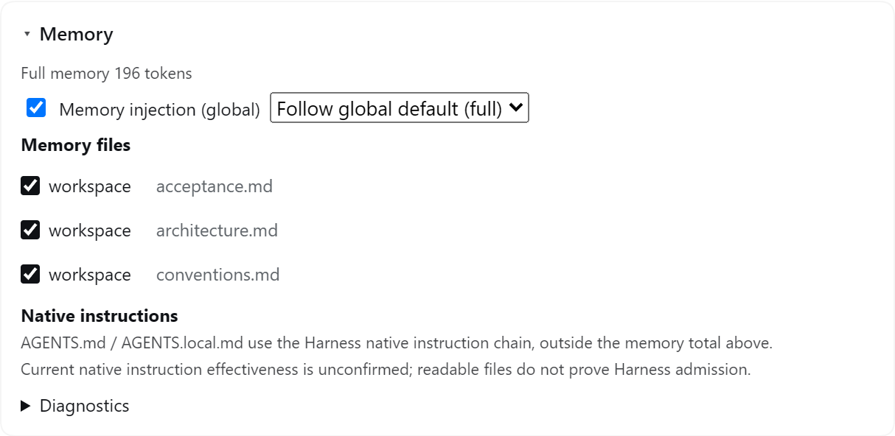
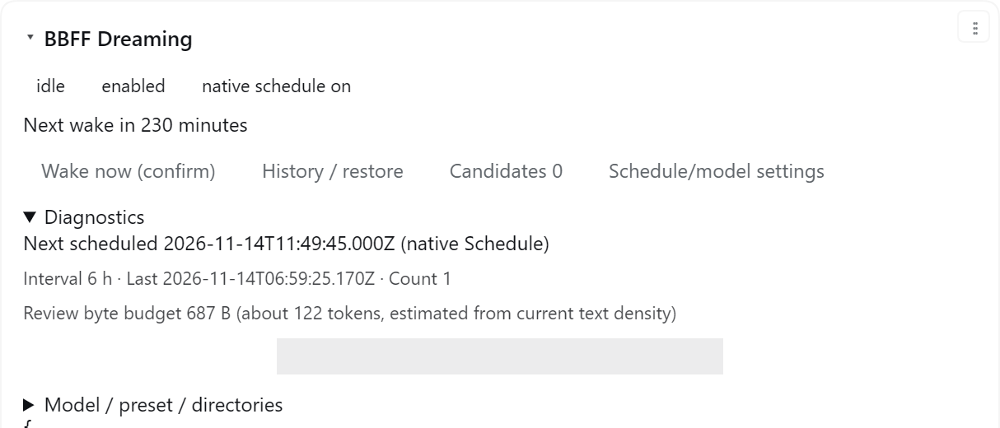
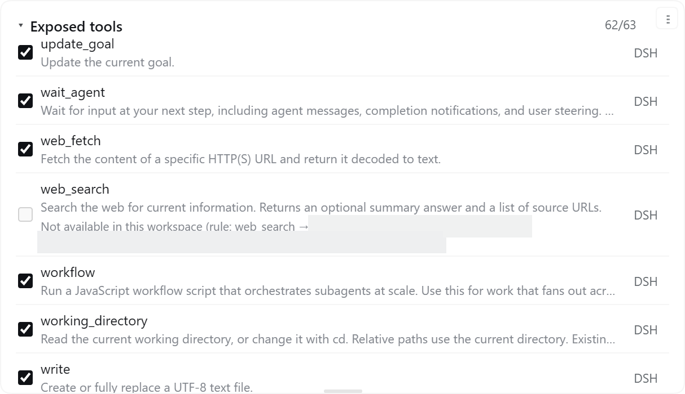
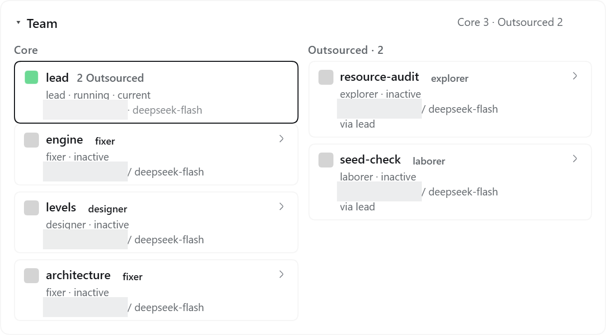
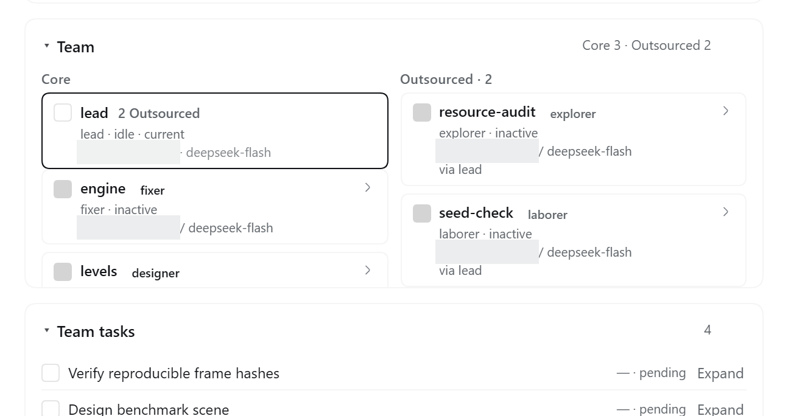
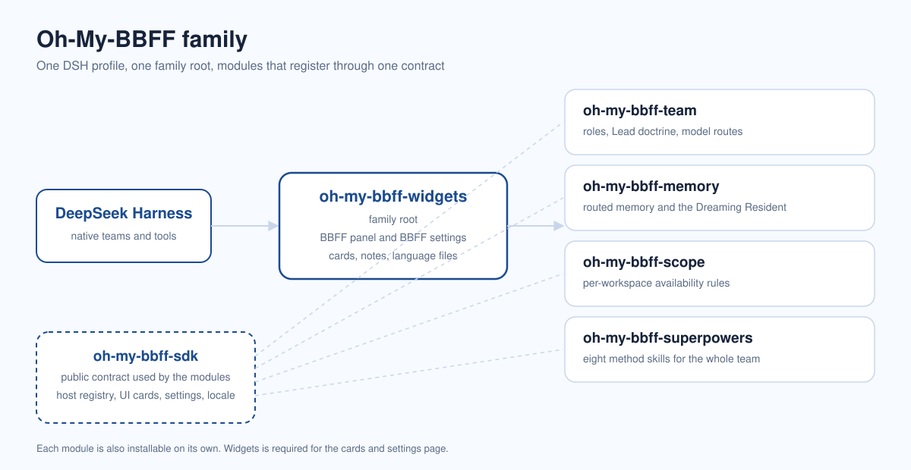

# Oh-My-BBFF
DSH's native subagents and team answer "can an agent manage a team." Oh-My-BBFF answers "how an agent manages a team."

[English](README.md) | [简体中文](README.zh-CN.md)



Building a team is open to anyone, but running one well is a craft. Oh-My-BBFF makes one mature way of running a team reproducible so every new session's team starts from the same method. Anyone can start a company and hire people, but not everyone can build an organisation that runs well.

[](https://www.bilibili.com/video/BV1DKsJ6TE49/)

▶ Watch the 2-minute video on Bilibili: [bilibili.com/video/BV1DKsJ6TE49](https://www.bilibili.com/video/BV1DKsJ6TE49/)

## How the Lead runs the team

### The Lead is a Manager, not an Executor
The Lead orchestrates, decomposes work, picks a role for each task, briefs members, reviews results, and reports to you. It does not do the work itself.


### The Lead knows its people
The built-in roles are inspired by [oh-my-opencode-slim](https://github.com/alvinunreal/oh-my-opencode-slim). Of these, explorer, librarian, oracle, designer and fixer follow its role division, and Oh-My-BBFF adds writer and laborer. The Lead knows who to call for a job. Each role brief defines its deliverable and boundaries, and permissions are enforced at the tool level (e.g., explorer and oracle cannot write files). Each role's model tiers come from the models you have configured in DSH, with notes on when to use each (e.g., `deepseek-v4.1-flash`, `gpt-6.1-sol`, `claude-opus-5-5`, `gemini-4-argon-high`). The Lead picks a tier explicitly and never switches automatically. You can edit roles, prompts, and tiers in BBFF settings without a restart, and changes are recorded.

For example, a cautious reviewer model might tend to over-defend its findings. The Lead recognizes this trait and weighs its output, filtering out unnecessary defensiveness before passing the findings to the implementer, rather than forwarding them verbatim.



### The Lead sees what each member is doing
The Lead reads a roster with every member's role, model, running/idle status, context usage, and last report. It also checks a member's recent tool calls and outputs with timestamps, so it catches rabbit holes or commands that never return. Because the Lead knows what each member knows, it writes better briefs.


### The team evolves with the project
The Lead maintains core seats—long-lived members with standing responsibility (e.g., architecture, engine, levels in a game team)—and dispatches outsourced agents for bounded tasks, which are reusable for follow-ups. The Lead also compacts a member's context, changes its model (effective from its next turn), or rebinds its role as the project's needs change.



## What a good team also needs

### Memory
Two modes (resident vs. routed): resident keeps all memory in context, while routed injects only files matching the recent conversation (using an index and tools as fallback). The Dreaming Resident is a dedicated session that reviews what the user said, rewriting, merging, or archiving entries instead of only appending. Every change is archived and revertible, a no-change review is normal, and only the main session writes. The budget is a share of the context window (default 10%) counted with a real tokenizer.





### Scope
Per-workspace availability control: one DSH profile, many workspaces, each with only what it needs. It shows the real source of every tool. This is availability control, not a security sandbox.



### Superpowers
Method-based skills: brainstorming, writing-plans, test-driven-development, systematic-debugging, verification-before-completion, independent-review, bbff-team-leading, bbff-team-member.


## You stay in charge
Everything comes back to the human. The BBFF panel gives you a clear view of the team's state and progress. Cards cover exposed skills, tools and MCP servers, the goal and its history, the Team, team tasks, agent todos, Memory, Dreaming, and team reports. Settings show the few most important first. Notes are never injected. The UI follows DSH's language, and a new language is one copied file.





## The family
| Package | What it is |
|---|---|
| `oh-my-bbff-widgets` | Family root, dockable cards, BBFF settings, and Notes. |
| `oh-my-bbff-team` | Team management, roles, and Lead tools. |
| `oh-my-bbff-memory` | Memory routing and the Dreaming Resident. |
| `oh-my-bbff-scope` | Per-workspace availability controls. |
| `oh-my-bbff-superpowers` | Method-based skills for teams. |
| `oh-my-bbff-sdk` | Plugin contract for third-party extensions. |

`oh-my-bbff` is the family bundle. Installing it installs `oh-my-bbff-widgets`, `oh-my-bbff-team`, `oh-my-bbff-memory`, `oh-my-bbff-scope` and `oh-my-bbff-superpowers` in one step. `oh-my-bbff-sdk` is only for third-party plugin developers.



## Install
Requires DeepSeek Harness >= 0.2.2 and pnpm. DSH installs plugins with pnpm, so pnpm must be on the PATH that DSH runs with. If `pnpm -v` fails in your terminal, run `npm install -g pnpm`, then restart DSH.

Each of the four ways below installs the whole family (`oh-my-bbff`). No restart is needed.

**1. Package name (recommended)**
- In the DSH Web UI, go to **Plugins → Add plugin**, enter `oh-my-bbff`, then click **Install** and **Enable now**.
- From a terminal:
  ```bash
  dsh plugin --profile web add oh-my-bbff
  ```

**2. GitHub repository**
- In **Plugins → Add plugin**, enter `https://github.com/BB-84C/Oh-My-BBFF`, then click **Install** and **Enable now**. From a terminal:
  ```bash
  dsh plugin --profile web add https://github.com/BB-84C/Oh-My-BBFF
  ```

**3. Discover (plugin index)**
1. In **Plugins → Experimental plugins**, turn on **Custom plugin indexes**. A **Discover** tab appears.
2. In **Discover → Add index source**, paste `https://raw.githubusercontent.com/BB-84C/Oh-My-BBFF/main/plugin-index.json`.
3. Install **oh-my-bbff**, then turn it on in **Installed → Installed plugins**.

**4. Local clone**
```bash
git clone https://github.com/BB-84C/Oh-My-BBFF.git
dsh plugin --profile web add "file:/absolute/path/to/Oh-My-BBFF"
```
Keep the `file:` prefix. On Windows, write the path as `file:D:\path\to\Oh-My-BBFF`. A plain directory path installs in development link mode, which needs `pnpm install` inside the clone first.

**Single plugins.** Every plugin can also be installed on its own: by package name (`oh-my-bbff-widgets`, `oh-my-bbff-team`, `oh-my-bbff-memory`, `oh-my-bbff-scope`, `oh-my-bbff-superpowers`), from GitHub with a path (`https://github.com/BB-84C/Oh-My-BBFF#path:packages/oh-my-bbff-widgets`), or from a local clone (`file:<clone>/packages/oh-my-bbff-widgets`). Install `oh-my-bbff-widgets` first, since it is the family root. Use either the bundle or single plugins, not both.

**First run:**
1. Choose a workspace folder (a fresh DSH install has none selected).
2. Turn on Agent Teams in the conversation before hiring core seats.
3. Open the BBFF panel and BBFF settings.

## Compatibility and known limitations
Compatible with DSH >= 0.2.2. See [docs/KNOWN-LIMITATIONS.md](docs/KNOWN-LIMITATIONS.md).

## Acknowledgements
Thank you to the following projects, their creators, and their contributors. Oh-My-BBFF follows and has learned from their spirit in many places — from specialist agent roles and permission boundaries to disciplined planning, debugging, and evidence-based verification:

- [oh-my-opencode-slim](https://github.com/alvinunreal/oh-my-opencode-slim) — created by Alvin ([@alvinunreal](https://github.com/alvinunreal))
- [Superpowers](https://github.com/obra/superpowers) — created by Jesse Vincent ([@obra](https://github.com/obra))
- **[GaugeForge PTE LTD](https://gauge-forge.com/)** — for supporting technical resources

See [THIRD_PARTY_NOTICES.md](THIRD_PARTY_NOTICES.md) for the MIT notice covering the adapted Superpowers skill texts.

## License
MIT, Copyright (c) 2026 Siyu Cheng.
