# Oh-My-BBFF
DSH 原生的 subagent 和 team 回答的是“agent 能不能管理团队”。Oh-My-BBFF 则回答的是“agent 应该怎样管理团队”。

[English](README.md) | [简体中文](README.zh-CN.md)

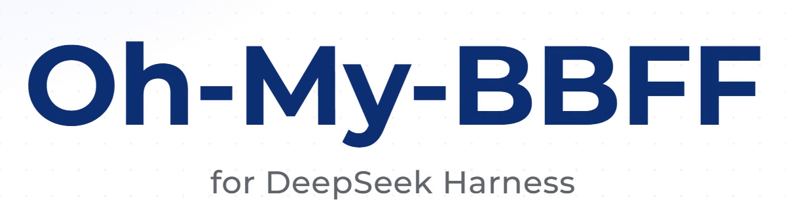

构建团队门槛很低，但将其运行得井井有条是一门手艺。Oh-My-BBFF 将一套成熟的团队管理模式转化为可复制的规范，确保每一个新的会话都能以同样成熟的方法起步。任何人都能开一家公司招人干活，但不是每个人都能建立起一套运行良好的组织架构。

[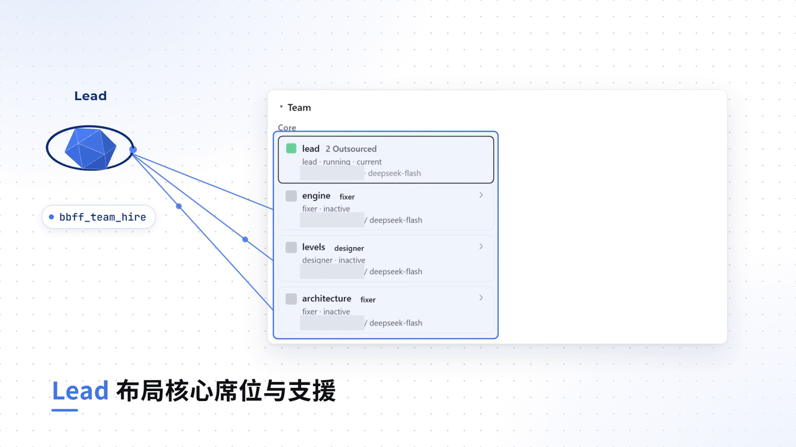](https://www.bilibili.com/video/BV1DKsJ6TE49/)

▶ 在 B 站观看 2 分钟介绍视频：[bilibili.com/video/BV1DKsJ6TE49](https://www.bilibili.com/video/BV1DKsJ6TE49/)

## Lead 如何管理团队

### Lead 负责指挥与规划，而不执行具体工作
Lead 负责拆解任务、分配角色、下达简报、审查成果并向你汇报，它本身不执行具体操作。


### Lead 知人善任
内置角色受 [oh-my-opencode-slim](https://github.com/alvinunreal/oh-my-opencode-slim) 启发。其中 explorer、librarian、oracle、designer、fixer 沿用了它的角色分工，Oh-My-BBFF 另外加入了 writer 与 laborer。Lead 清楚每种角色适合做什么。每种角色都配备了明确的简报，规定了何时使用、交付物是什么以及工作边界，权限在工具级别强制执行（如 explorer 和 oracle 无法写入文件）。每种角色的模型档位取自你在 DSH 中已配置的模型，并附有使用说明（例如 `deepseek-v4.1-flash`, `gpt-6.1-sol`, `claude-opus-5-5`, `gemini-4-argon-high`）。Lead 明确选择模型，从不自动切换。你可以在 BBFF 设置面板中编辑角色、提示词与档位，无需重启，且修改会被记录。

例如，当 oracle 角色由一个倾向过度防御的模型担任时，Lead 会识别其行为，并在将结果传递给 fixer 之前对其发现进行甄别，剔除那些低收益的过度防御性意见，而不是不加过滤地直接转发。

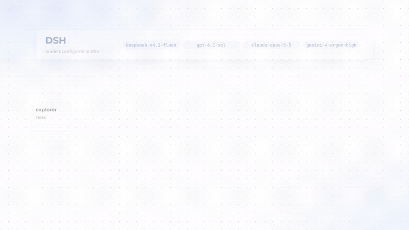

### Lead 看得见每个成员在做什么
Lead 通过花名册查看每位成员的角色、模型、运行状态、上下文占用及最后一份汇报。它还会查看成员最近的工具调用与输出记录，及时发现陷入死循环或因命令卡死而无法回复的成员。Lead 清楚每个成员知道什么，因此能下达更好的简报。

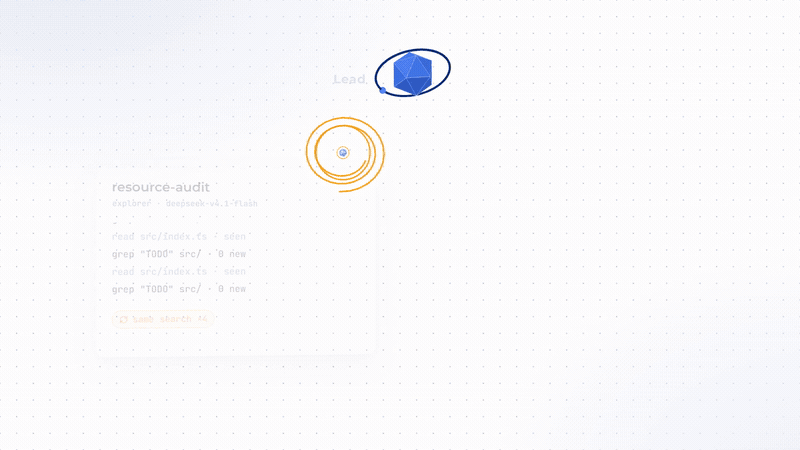

### 团队随项目演进
Lead 维护核心岗位（负责长期职责，如游戏团队中的架构、引擎、关卡）并调度外包 agent 处理特定任务，这些外包 agent 可重复用于后续跟进工作。Lead 还会压缩成员的上下文、更换成员的模型（从下一次运行生效）或重新绑定角色，让团队随项目进度保持精简与高效。

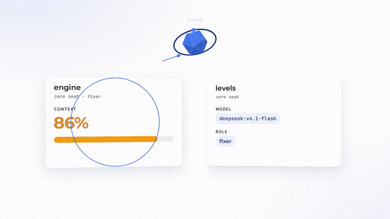

## 高效团队必备的其他能力

### 记忆系统（Memory）
两种模式（全量注入 vs 路由检索）：全量注入将所有记忆保持在上下文，路由检索则在每一轮注入与近期对话匹配的文件（以索引和工具作为兜底）。Dreaming Resident 是一个专属会话，它会审阅对话并重写、合并或归档记忆条目，而不是单纯追加。每一次变更都会存档并可还原，不产生变更的审阅是常态，且仅主会话写入。记忆预算是上下文窗口的共享份额（默认 10%），由真实 Tokenizer 计算。

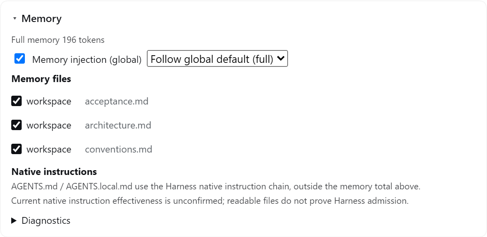

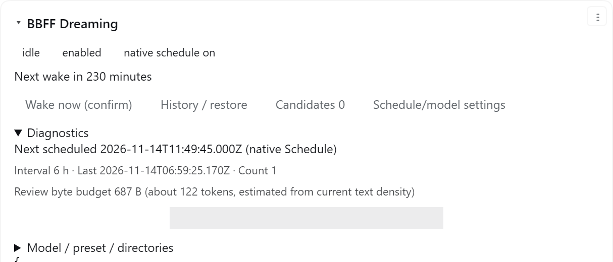

### 工作区范围（Scope）
按工作区进行可用性控制：一个 DSH profile 对应多个工作区，每个工作区仅包含它所需的资源。它会显示每个工具的真实来源。它是可用性控制，不是安全沙箱。

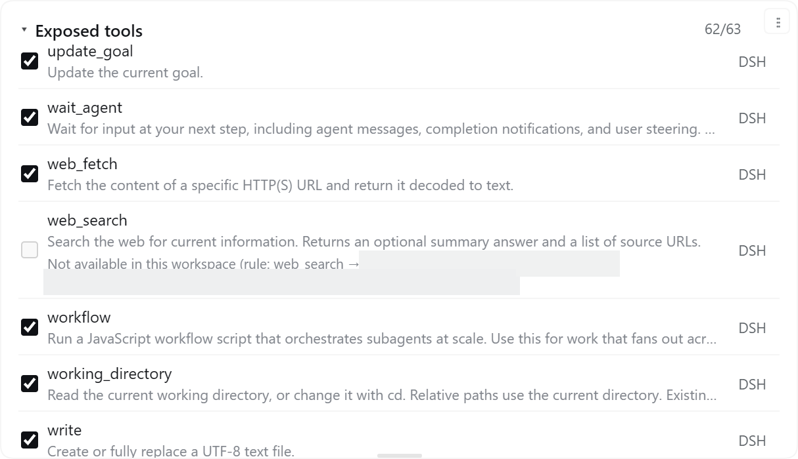

### Superpowers
基于方法论的技能库：brainstorming, writing-plans, test-driven-development, systematic-debugging, verification-before-completion, independent-review, bbff-team-leading, bbff-team-member。


## 一切最终都回到人身上
BBFF 面板提供了一个清晰的团队状态与进度视图。卡片包括已暴露的技能、工具与 MCP 服务，目标与目标历史，以及团队、团队任务、模型待办、记忆、BBFF Dreaming 和团队汇报。设置页先显示最重要的几项。笔记不会被注入给模型。UI 遵循 DSH 的语言设置，新增一种语言只需复制一个文件。

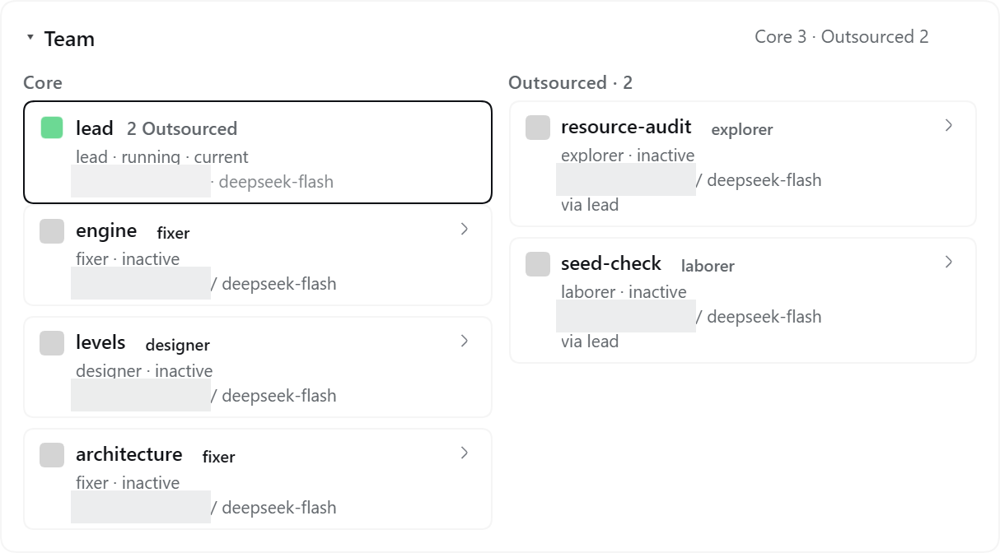

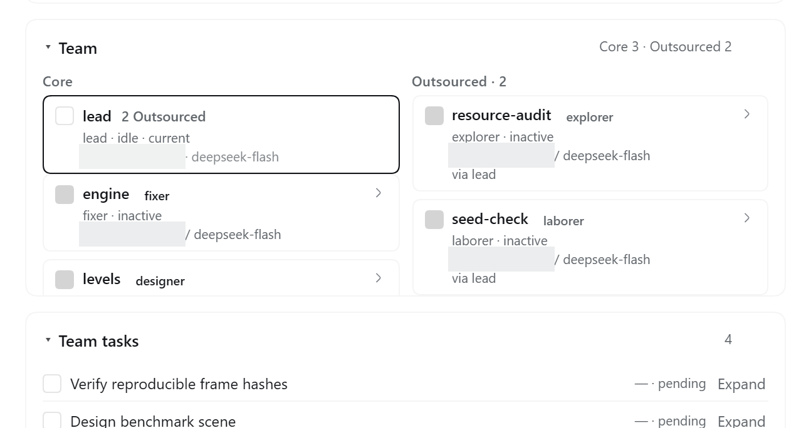

## 家族系列插件
| 插件 | 功能说明 |
|---|---|
| `oh-my-bbff-widgets` | 家族根插件，BBFF 面板、设置页与笔记功能。 |
| `oh-my-bbff-team` | 团队管理、角色体系与 Lead 工具。 |
| `oh-my-bbff-memory` | 记忆路由与Dreaming Resident。 |
| `oh-my-bbff-scope` | 按工作区控制工具、MCP 服务与技能的可用性。 |
| `oh-my-bbff-superpowers` | 团队方法论技能库。 |
| `oh-my-bbff-sdk` | 第三方插件集成的契约接口。 |

`oh-my-bbff` 是整套插件的总包，安装它就会一次装好 `oh-my-bbff-widgets`、`oh-my-bbff-team`、`oh-my-bbff-memory`、`oh-my-bbff-scope` 和 `oh-my-bbff-superpowers`。`oh-my-bbff-sdk` 只供第三方插件开发使用。

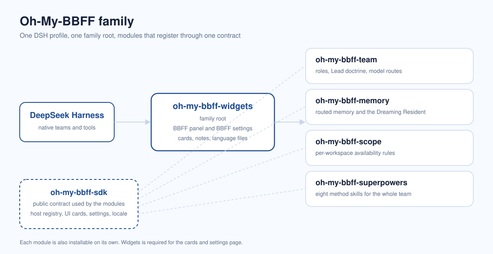

## 安装
需要 DeepSeek Harness >= 0.2.2 和 pnpm。DSH 用 pnpm 安装插件，所以 DSH 运行时必须能在 PATH 中找到 pnpm。如果终端里 `pnpm -v` 报错，先运行 `npm install -g pnpm`，再重启 DSH。

下面四种方式任选其一，都会装好整套插件（`oh-my-bbff`）。安装后无需重启 DSH。

**1. 包名（推荐）**
- 在 DSH Web 界面中，进入 **插件（Plugins） → 添加插件（Add plugin）**，输入 `oh-my-bbff`，点击安装（Install）后再点击立即启用（Enable now）。
- 在终端中：
  ```bash
  dsh plugin --profile web add oh-my-bbff
  ```

**2. GitHub 仓库**
- 在 **添加插件（Add plugin）** 中输入 `https://github.com/BB-84C/Oh-My-BBFF`。在终端中：
  ```bash
  dsh plugin --profile web add https://github.com/BB-84C/Oh-My-BBFF
  ```

**3. 发现（Discover，插件索引）**
1. 在 **插件（Plugins） → 实验性插件（Experimental plugins）** 中开启 **自定义插件索引（Custom plugin indexes）**，插件页会出现 **发现（Discover）** 标签页。
2. 在 **发现 → 添加索引源（Add index source）** 中粘贴 `https://raw.githubusercontent.com/BB-84C/Oh-My-BBFF/main/plugin-index.json`。
3. 安装 **oh-my-bbff**，再到 **已安装（Installed） → 已安装插件（Installed plugins）** 中开启它。

**4. 本地克隆**
```bash
git clone https://github.com/BB-84C/Oh-My-BBFF.git
dsh plugin --profile web add "file:/克隆目录的绝对路径/Oh-My-BBFF"
```
请保留 `file:` 前缀。直接填写目录路径会以开发链接模式安装，需要先在克隆目录里运行 `pnpm install`。

**单独安装某个插件。** 每个插件也可以单独安装：用包名（`oh-my-bbff-widgets`、`oh-my-bbff-team`、`oh-my-bbff-memory`、`oh-my-bbff-scope`、`oh-my-bbff-superpowers`），用带路径的 GitHub 地址（`https://github.com/BB-84C/Oh-My-BBFF#path:packages/oh-my-bbff-widgets`），或用本地克隆（`file:<克隆目录>/packages/oh-my-bbff-widgets`）。请先装 `oh-my-bbff-widgets`，它是家族根插件。总包和单独安装二选一，不要混用。

**首次使用：**
1. 选择一个工作区目录（全新安装的 DSH 默认未选择工作区）。
2. 在对话中开启 Agent Teams，然后再招募核心岗位成员。
3. 打开 BBFF 面板与 BBFF 设置。

## 兼容性与已知限制
兼容 DSH >= 0.2.2。详见 [docs/KNOWN-LIMITATIONS.md](docs/KNOWN-LIMITATIONS.md)。

## 致谢
感谢以下项目、作者及所有贡献者。Oh-My-BBFF 在许多地方沿用并学习了它们的精神——从角色分工与权限边界，到有纪律的规划、调试与基于证据的验证：

- [oh-my-opencode-slim](https://github.com/alvinunreal/oh-my-opencode-slim) — 作者 Alvin（[@alvinunreal](https://github.com/alvinunreal)）
- [Superpowers](https://github.com/obra/superpowers) — 作者 Jesse Vincent（[@obra](https://github.com/obra)）
- **[GaugeForge PTE LTD](https://gauge-forge.com/)** — 提供技术资源支持

改编自 Superpowers 的技能文本及其 MIT 许可声明见 [THIRD_PARTY_NOTICES.md](THIRD_PARTY_NOTICES.md)。

## 许可证
MIT, Copyright (c) 2026 Siyu Cheng.
